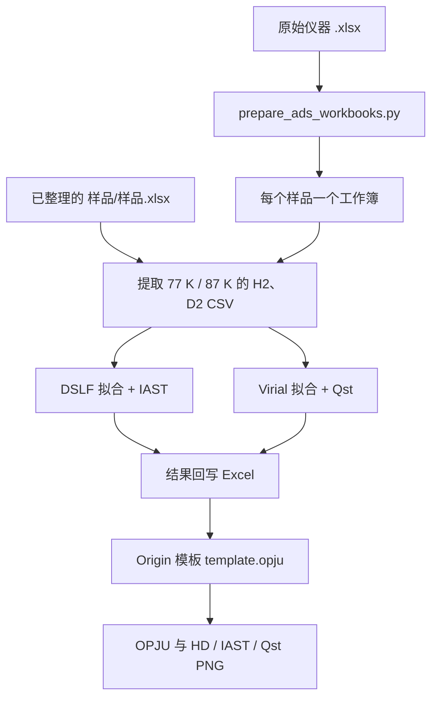
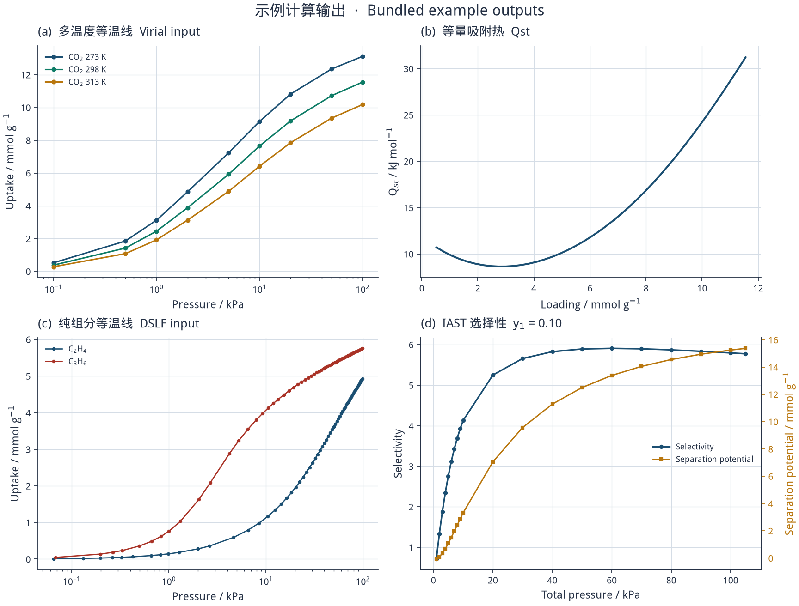

# isotope-adsorption-auto

**English.** A portable workflow for hydrogen-isotope adsorption analysis. It turns instrument workbooks into per-sample files, fits pure-component isotherms, estimates mixture selectivity with ideal adsorbed solution theory (IAST), computes the isosteric heat of adsorption (Qst) from a virial equation, and drives Origin to export OPJU/PNG figures. The C++ calculators build from source; Windows binaries are meant to be published as GitHub Releases rather than committed to the repository.

面向多孔材料上 H2/D2 同位素吸附数据的自动化计算与作图。仓库提供从原始 Excel 到 IAST 选择性、等量吸附热和 Origin 图的完整流程，计算核心是零第三方依赖的 C++17 程序。

## 背景

H2 与 D2 的动力学直径几乎相同，常规尺寸筛分很难分开它们。在沸石和金属有机框架（MOF）的窄孔中，低温下的量子筛分会使两种同位素的吸附平衡出现可测量的差异。实验上通常先测 77 K 与 87 K 的单组分等温线，再用模型估计混合物选择性和吸附焓。

本仓库把这条分析链固定下来：

- 整理仪器导出的原始工作簿
- 用双位点 Langmuir–Freundlich（DSLF）拟合纯组分等温线
- 用 IAST 由纯组分等温线预测 H2/D2 竞争吸附与选择性
- 用 virial 方程由两个温度的等温线计算等量吸附热 Qst
- 把结果写回 Excel，并按模板在 Origin 中导出图

示例图使用仓库自带的 CO2 与烯烃等温线，用来展示计算输出的形状。它们不是未发表的同位素实验数据。

## 模型

纯组分平衡吸附量用双位点 Langmuir–Freundlich 方程描述。单组分也可退化为单位点 Langmuir（SSL）、双位点 Langmuir（DSL）或单位点 Langmuir–Freundlich（SSLF）。`Auto` 模式按贝叶斯信息准则在这些模型中选择，并丢弃指数塌缩到正约束边界的病态解。

$$
q(P)=\sum_{i=1}^{2} q_{s,i}\frac{b_i P^{n_i}}{1+b_i P^{n_i}}
$$

IAST 假定吸附相是理想溶液。在相同铺展压力下求解各组分的纯组分虚拟压力，再由气相摩尔分数得到吸附相组成。二元选择性为

$$
S_{1/2}=\frac{x_1/y_1}{x_2/y_2}
$$

等量吸附热来自 virial 展开。多温度数据同时拟合

$$
\ln P=\ln N+\frac{1}{T}\sum_{i=0}^{m} a_i N^i+\sum_{j=0}^{n} b_j N^j
$$

覆盖度 \(N\) 处的吸附热（kJ/mol）为

$$
Q_{st}(N)=-R\sum_{i=0}^{m} a_i N^i
$$

程序会在给定最高阶数内比较候选 \((m,n)\)，结合 BIC 和 Qst 曲线稳定性选择阶数，并给出参数与 Qst 的标准误差。

## 架构



| 路径 | 作用 |
| --- | --- |
| `scripts/Invoke-IsotopeAdsorptionAuto.ps1` | 从本仓库启动完整流程 |
| `scripts/Deploy-IsotopeAdsorptionAuto.ps1` | 把流程复制到另一个工作目录 |
| `assets/auto-workflow/` | 整理、计算、回写和作图脚本 |
| `assets/auto-workflow/IAST_Auto_Template/source/` | IAST 核心、命令行和 Windows 界面 |
| `assets/auto-workflow/Qst_Auto_Template/source/` | Qst 核心、命令行和 Windows 界面 |
| `assets/auto-workflow/Origin_Auto_Template/` | Origin COM 作图与轴范围配置 |
| `SKILL.md` | 供 Codex 一类助手读取的技能说明 |

默认样品列表是占位符 `Sample-A` 到 `Sample-H`。运行前改成你自己的文件夹名，或用 `-Samples` 显式传入。Qst 图使用配置里的共用纵轴范围；只有某个样品需要单独范围时，才在 `manualYBySample` 中添加。

## 安装与编译

完整作图流程需要 Windows PowerShell、Python 3 与 `openpyxl`、桌面版 Excel，以及启用了 `Origin.ApplicationSI` 的 Origin。IAST/Qst 计算本身只依赖 C++17 编译器。

```powershell
python -m pip install openpyxl
```

可执行文件不放在 Git 里。克隆之后从源码编译，或在发布页下载 Windows 构建。

### Linux / macOS 命令行

```bash
bash scripts/build_cpp.sh
./build/iast_calc --help
./build/qst_calc --help
```

产物是 `build/iast_calc` 和 `build/qst_calc`，以及两个单元测试程序。图形界面使用 Win32，只在 Windows 上编译。

### Windows

安装 Visual Studio 2022（或 Build Tools）的“使用 C++ 的桌面开发”工作负载后：

```powershell
.\scripts\build_cpp.ps1
```

脚本会编译命令行程序、单元测试和 GUI，并把流程实际调用的文件放到：

- `assets/auto-workflow/IAST_Auto_Template/iast_calc_gui.exe`
- `assets/auto-workflow/Qst_Auto_Template/qst_calc_cli.exe`
- `assets/auto-workflow/Qst_Auto_Template/qst_calc_gui.exe`

也可以进入各自的 `source/` 目录运行 `build_gui.bat`。这些 `.exe` 已被 `.gitignore` 忽略。

### GitHub Releases

预编译的 Windows 程序计划通过 GitHub Releases 发布，而不是提交进仓库。本次改动没有创建 Release。合并后在 Releases 页面上传上述三个可执行文件即可。

用命令行直接计算示例数据：

```bash
./build/qst_calc \
  --temp1 273 --csv1 assets/auto-workflow/Qst_Auto_Template/example/CO2_273K.csv \
  --temp2 298 --csv2 assets/auto-workflow/Qst_Auto_Template/example/CO2_298K.csv \
  --temp3 313 --csv3 assets/auto-workflow/Qst_Auto_Template/example/CO2_313K.csv \
  --output-dir /tmp/qst-example -o Qst_result

./build/iast_calc \
  --gas1 C3H6 --csv1 assets/auto-workflow/IAST_Auto_Template/example/C3H6.csv --model1 DSLF \
  --gas2 C2H4 --csv2 assets/auto-workflow/IAST_Auto_Template/example/C2H4.csv --model2 DSLF \
  --y1 0.1 --y2 0.9 --output-dir /tmp/iast-example -o IAST_result
```

## 使用

已整理好的输入目录：

```text
<输入根目录>/<样品名>/<样品名>.xlsx
```

每个工作簿需要 H2-77K、D2-77K、H2-87K、D2-87K。原始仪器文件名需要能识别样品、温度和气体，例如 `Sample-A_77K-H2.xlsx`。

```powershell
.\scripts\Invoke-IsotopeAdsorptionAuto.ps1 -InputRoot <输入根目录>
.\scripts\Invoke-IsotopeAdsorptionAuto.ps1 -InputRoot <原始Excel目录> -PrepareRawInput
.\scripts\Invoke-IsotopeAdsorptionAuto.ps1 -InputRoot <输入根目录> -Samples Sample-A,Sample-B
.\scripts\Invoke-IsotopeAdsorptionAuto.ps1 -InputRoot <输入根目录> -SkipOrigin
.\scripts\Invoke-IsotopeAdsorptionAuto.ps1 -InputRoot <输入根目录> -SkipCalculate
```

每个样品目录会得到四份吸附 CSV、`IAST结果`、`Qst结果`、`<样品>.opju`，以及 HD / IAST / Qst 的 PNG。Qst 出现负值时只跳过该样品的 Qst 图，其余输出继续。运行报告在 `logs/full_workflow_report.txt` 和 `Origin_Auto_Template/logs/workflow_report.csv`。

更细的表格名、依赖检查和排错见 `references/workflow-guide.md`。

## 示例输出

下图由 `docs/generate_example_figure.py` 根据仓库内示例数据绘制：(a)(b) 是 CO2 三温度 virial/Qst 示例，Qst 取自已保存的自动选阶结果；(c)(d) 是 C2H4/C3H6 的 DSLF 与 IAST 示例（气相摩尔分数 0.10 / 0.90）。



```bash
python -m pip install -r requirements-dev.txt
python docs/generate_example_figure.py
```

## 测试

```bash
python -m pip install -r requirements-dev.txt
python -m pytest -q
bash scripts/build_cpp.sh /tmp/isotope-build
( cd /tmp && /tmp/isotope-build/iast_auto_fit_test && /tmp/isotope-build/qst_auto_fit_test )
```

单元测试覆盖 DSLF 吸附量与铺展压力、对称等温线的 IAST 选择性、virial 吸附热公式、自动拟合，以及原始 Excel 的单位换算和吸脱附分段。GitHub Actions 在 Ubuntu 上运行 pytest 和 C++ 构建，在 Windows 上用 MSVC 编译命令行程序、GUI 和单元测试。

## 许可

[MIT License](LICENSE)。Copyright (c) 2026 GYJ-gif / 郭源杰。
